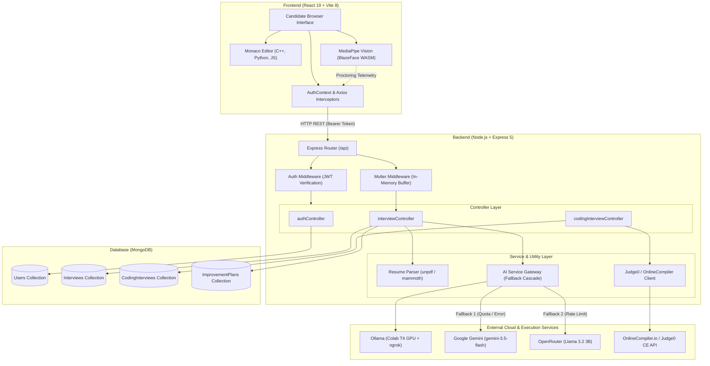

# AI Interview Platform

An AI-powered interview preparation platform featuring intelligent interview generation, automated evaluation, coding assessments, and real-time proctoring.

[](https://nodejs.org/)
[](https://expressjs.com/)
[](https://react.dev/)
[](https://vitejs.dev/)
[](https://www.mongodb.com/)
[](https://microsoft.github.io/monaco-editor/)
[](https://developers.google.com/mediapipe)
[](#testing)

---

## Table of Contents

- [Overview](#overview)
  - [The Problem](#the-problem)
  - [The Solution](#the-solution)
  - [Interview Modes](#interview-modes)
- [Key Features](#key-features)
  - [1. Authentication & Candidate Dashboard](#1-authentication--candidate-dashboard)
  - [2. Regular AI Interview Mode](#2-regular-ai-interview-mode)
  - [3. Resume Parsing & Extraction](#3-resume-parsing--extraction)
  - [4. Coding Interview Mode](#4-coding-interview-mode)
  - [5. AI Proctoring & Anti-Cheating](#5-ai-proctoring--anti-cheating)
  - [6. Multi-Provider AI Engine & Fallback Cascade](#6-multi-provider-ai-engine--fallback-cascade)
- [Technology Stack](#technology-stack)
- [System Architecture](#system-architecture)
  - [Architecture Diagram](#architecture-diagram)
  - [Component Responsibilities](#component-responsibilities)
- [Project Directory Structure](#project-directory-structure)
- [Project Screenshots](#project-screenshots)
- [Installation and Local Setup](#installation-and-local-setup)
  - [Prerequisites](#prerequisites)
  - [Step-by-Step Installation](#step-by-step-installation)
- [Environment Variables](#environment-variables)
- [Ollama Setup (Google Colab & ngrok)](#ollama-setup-google-colab--ngrok)
- [Code Execution Setup (OnlineCompiler.io / Judge0)](#code-execution-setup-onlinecompilerio--judge0)
- [API Documentation](#api-documentation)
- [Testing](#testing)
- [Security and Privacy](#security-and-privacy)
- [Known Limitations](#known-limitations)
- [Future Enhancements](#future-enhancements)
- [Contributing](#contributing)
- [License](#license)
- [Acknowledgements](#acknowledgements)

---

## Overview

### The Problem
Traditional technical interview preparation is often fragmented, costly, and static. Job candidates solve isolated LeetCode algorithms or rehearse answers from canned question lists without structured feedback, realistic pressure, personalized follow-ups, or holistic performance analysis across technical depth, communication, and practical reasoning.

### The Solution
**AI Interview Platform** is an end-to-end simulation environment that reproduces the rigor of technical and coding interviews. Candidates can generate tailored interview sessions manually or directly from their uploaded resume, write real-time answers with AI follow-up probes, solve programming challenges in a cloud-sandboxed Monaco code editor, and review granular metrics on a comprehensive evaluation report.

### Interview Modes
The platform provides two dedicated assessment tracks:

1. **Regular AI Interview Mode**:
   Focuses on conceptual, behavioral, architectural, and domain-specific technical questions. Incorporates candidate resume grounding, live MediaPipe camera tracking, multi-criterion answer evaluation, adaptive follow-up questions, and automated 5-day improvement roadmaps.
2. **Coding Interview Mode**:
   Focuses on algorithmic and implementation challenges across Python, JavaScript, and C++. Pairs Monaco editor ergonomics with secure remote execution (Judge0 CE / OnlineCompiler.io API), test case input/output comparison, compilation/runtime diagnostics, and strict anti-cheating controls (copy/paste blocking, tab-switch logging, face tracking).

---

## Key Features

### 1. Authentication & Candidate Dashboard
- **Secure Authentication**: User registration and login utilizing bcrypt password hashing and stateless JSON Web Tokens (JWT).
- **Personalized Candidate Dashboard**: Aggregates interview history, completion status, overall scores, and quick action cards for starting new technical or coding sessions.
- **Session Management**: Resume uncompleted interviews or inspect historical scorecards and evaluation histories.

### 2. Regular AI Interview Mode
- **Flexible Session Creation**: Create interviews by specifying role, experience level, tech stack, and difficulty, or upload a resume for automatic contextualization.
- **AI Question Generation**: Dynamically constructs question sets tailored to the candidate's target profile.
- **Multi-Criterion Answer Scoring**: Evaluates answers across five distinct dimensions (1–10 scale):
  - *Technical Accuracy* (concepts, syntax, correctness)
  - *Completeness* (depth and edge-case coverage)
  - *Clarity* (articulation and structure)
  - *Problem Solving* (analytical approach and trade-off analysis)
  - *Practical Understanding* (real-world applicability and best practices)
- **Dynamic Follow-Up Probing**: Analyzes candidate answers and generates relevant technical follow-up questions when responses warrant deeper verification.
- **Comprehensive Summary Reports**: Calculates cumulative scores, identifies strongest and weakest skills, and highlights actionable growth areas.
- **Personalized 5-Day Improvement Plans**: Synthesizes weaknesses into a structured 5-day daily action plan with specific objectives, estimated completion times, and practical exercises.

### 3. Resume Parsing & Extraction
- **Multi-Format Support**: In-memory parsing of PDF (`unpdf`, `pdf-parse`) and Word documents (`mammoth` for `.docx` and `.doc`).
- **Buffer-Based Processing**: Files are processed entirely in memory via Multer memory storage; no candidate resumes are permanently stored on disk.
- **Input Validation**: Strict file type filtering, MIME verification, and a 5 MB file size boundary.
- **Resume-Grounded Generation**: Questions reference candidate projects, tech stacks, and work history extracted from the uploaded document.

### 4. Coding Interview Mode
- **Multi-Language Monaco Editor**: Embedded VS Code-grade Monaco Editor with syntax highlighting, line numbering, auto-closing brackets, and dark theme support.
- **Supported Languages**: Python (3.x), JavaScript (Node.js), and C++ (GCC).
- **Custom Standard Input**: Candidates can supply custom `stdin` inputs to test edge cases before submitting.
- **Cloud-Sandboxed Execution**: Submissions are routed to an isolated remote sandbox (Judge0-compatible API) to capture `stdout`, `stderr`, compilation errors, execution time, and peak memory usage.
- **Run vs. Submit Workflows**: Test solutions iteratively using "Run Code" and finalize answers using "Submit Code".

### 5. AI Proctoring & Anti-Cheating
- **Real-Time Computer Vision**: Uses Google MediaPipe Tasks Vision (`BlazeFace` short-range model running via WebAssembly/GPU delegate in the browser) to monitor the candidate's video feed.
- **Face Presence Tracking**: Triggers warnings if no face is detected for longer than 5 seconds (`face_not_detected`).
- **Multiple Face Detection**: Alerts the user if more than one face appears in the webcam frame (`multiple_faces`).
- **Tab-Switch & Window Blur Detection**: Tracks document visibility state changes and flags window blur events.
- **Fullscreen Exit Logging**: Monitors fullscreen state changes during coding assessments.
- **Clipboard & Interaction Restriction**: Intercepts and blocks clipboard operations inside the Monaco editor:
  - Disables keyboard shortcuts: `Ctrl+V`, `Cmd+V`, `Shift+Insert`, `Ctrl+C`, `Cmd+C`, `Ctrl+X`, `Cmd+X`.
  - Blocks DOM context menu (`right-click`).
  - Restricts drag-and-drop text injection into the editor buffer.
- **Integrity Event Timeline**: Logs all violation timestamps and durations, compiling a proctoring audit log displayed on the session result page.

> [!NOTE]
> Proctoring features run in the candidate's browser and serve as integrity indicators rather than absolute surveillance. Browser sandboxing prevents access to external monitors or physical external devices.

### 6. Multi-Provider AI Engine & Fallback Cascade
The backend includes a resilient AI service gateway supporting multiple model backends with automated fallback:

```
Ollama (Primary, when AI_PROVIDER=ollama)
   └── (Timeout / Failure / Unreachable)
         └──► Google Gemini (Fallback 1)
                 └── (Quota Exceeded / Rate Limit)
                       └──► OpenRouter (Fallback 2)
```

- **Ollama**: Self-hosted or Google Colab T4 GPU deployment running `llama3.2:1b` with native JSON mode (`format: "json"`).
- **Google Gemini**: Powered by the official `@google/genai` SDK using `gemini-3.5-flash`.
- **OpenRouter**: Cloud fallback using models such as `meta-llama/llama-3.2-3b-instruct:free`.
- **Resilience**: Automatically recovers from API timeouts, 429 quota exhaustion, network resets, and tunnel drops.

---

## Technology Stack

| Layer | Technology | Details |
| :--- | :--- | :--- |
| **Frontend Framework** | React 19 (`19.2.x`) | Single-page application bootstrapped with Vite 8 |
| **Routing** | React Router DOM 7 (`7.18.x`) | Client-side routing with `ProtectedRoute` guards |
| **Code Editor** | Monaco Editor (`@monaco-editor/react`) | VS Code editor core with language-specific highlighting |
| **Computer Vision** | MediaPipe Tasks Vision (`1.2.x`) | In-browser face detection via WebAssembly & GPU delegate |
| **HTTP Client** | Axios (`1.20.x`) | Intercepted client attaching JWT Bearer tokens |
| **Backend Runtime** | Node.js (v18+) | JavaScript runtime for backend services |
| **Web Framework** | Express.js 5 (`5.2.x`) | Modular REST API routing and middleware |
| **Database** | MongoDB & Mongoose 9 (`9.7.x`) | Document database with schema validation and subdocuments |
| **Authentication** | JWT & bcrypt | Stateless token authentication with bcrypt salt hashing |
| **Document Parsing** | `unpdf`, `mammoth`, `pdf-parse` | Multi-format PDF and Word resume text extraction |
| **AI Providers** | Ollama, Google GenAI, OpenRouter | Multi-model integration with automatic cascading fallback |
| **Code Execution** | OnlineCompiler.io / Judge0 CE | Sandboxed code runner with timeout and resource limits |
| **Tunneling** | ngrok CLI (v3+) | Authenticated reverse proxy with Traffic Policy headers |

---

## System Architecture

### Architecture Diagram



### Component Responsibilities

- **Frontend (Client)**:
  Handles UI rendering, interview workflows, Monaco Editor integration, camera access, and real-time MediaPipe face detection. Dispatches proctoring violation alerts to the backend while maintaining candidate session state.
- **Backend (Server)**:
  Exposes REST endpoints, validates authentication tokens, enforces resource ownership, handles multi-format file uploads, evaluates answers via AI prompts, and orchestrates code execution jobs.
- **Database (MongoDB)**:
  Stores users, structured interview sessions, question/answer histories, coding submissions, execution outputs, proctoring violation logs, and 5-day improvement roadmaps.
- **AI Service Gateway**:
  Normalizes prompts, handles JSON cleaning, enforces native JSON response modes, and manages the resilient fallback chain across Ollama, Gemini, and OpenRouter.
- **Code Execution Client**:
  Maps language identifiers, formats standard inputs, submits execution jobs to the remote Judge0-compatible API, polls for completion, and normalizes stdout, stderr, and resource metrics.

---

## Project Directory Structure

```
AI-Interview-Platform/
├── client/                              # Frontend React application
│   ├── public/                          # Static assets and favicons
│   ├── src/
│   │   ├── components/                  # Shared UI components
│   │   │   ├── Navbar.jsx               # Navigation bar with auth state
│   │   │   └── ProtectedRoute.jsx       # Route guard for authenticated views
│   │   ├── context/                     # Global state management
│   │   │   ├── AuthContext.jsx          # User credentials and session state
│   │   │   └── useAuth.js               # Custom authentication hook
│   │   ├── pages/                       # Application views
│   │   │   ├── Landing.jsx              # Landing page
│   │   │   ├── Login.jsx                # User login
│   │   │   ├── Register.jsx             # User registration
│   │   │   ├── Dashboard.jsx            # Candidate dashboard and history
│   │   │   ├── CreateInterview.jsx      # Manual/Resume interview creation
│   │   │   ├── Interview.jsx            # Regular interview session & proctoring
│   │   │   ├── InterviewResult.jsx      # Scorecards, summary & 5-day plan
│   │   │   ├── CreateCodingInterview.jsx# Coding interview setup
│   │   │   ├── CodingInterview.jsx      # Monaco code editor & execution
│   │   │   └── CodingInterviewResult.jsx# Coding scorecard & violation audit
│   │   ├── services/
│   │   │   └── api.js                   # Axios instance with auth interceptors
│   │   ├── App.css                      # Global styles and layout
│   │   ├── App.jsx                      # Route definitions
│   │   └── main.jsx                     # Application entry point
│   ├── package.json                     # Client dependencies and scripts
│   └── vite.config.js                   # Vite configuration
│
├── server/                              # Backend Express application
│   ├── config/
│   │   └── db.js                        # MongoDB connection handler
│   ├── controllers/
│   │   ├── authController.js            # Registration, login, profile
│   │   ├── interviewController.js       # Regular interviews, evaluation, plans
│   │   └── codingInterviewController.js # Coding sessions, runner, proctoring
│   ├── middleware/
│   │   ├── authMiddleware.js            # JWT verification and route protection
│   │   ├── upload.js                    # Multer upload configuration
│   │   └── uploadMiddleware.js          # In-memory file buffer validation
│   ├── models/
│   │   ├── User.js                      # User schema and credentials
│   │   ├── Interview.js                 # Regular interview session schema
│   │   ├── CodingInterview.js           # Coding session and proctoring schema
│   │   └── ImprovementPlan.js           # 5-day improvement plan schema
│   ├── prompts/
│   │   └── interviewPrompts.js          # Prompts for question gen, eval, summary
│   ├── routes/
│   │   ├── authRoutes.js                # /api/auth routes
│   │   ├── interviewRoutes.js           # /api/interviews routes
│   │   └── codingInterviewRoutes.js     # /api/coding-interviews routes
│   ├── Services/
│   │   └── aiService.js                 # AI provider gateway & fallback cascade
│   ├── utils/
│   │   ├── extractResumeText.js         # PDF text extractor
│   │   ├── generateToken.js             # JWT signer utility
│   │   ├── judge0Client.js              # Judge0 & OnlineCompiler execution client
│   │   ├── parseGeminiResponse.js       # JSON cleaning and extractor
│   │   └── resumeParser.js              # Multi-format unpdf & mammoth parser
│   ├── .env.example                     # Environment template
│   ├── package.json                     # Server dependencies and scripts
│   ├── server.js                        # Express server entry point
│   ├── testAiService.js                 # AI service & fallback tests
│   ├── testJudge0Client.js              # Code execution client tests
│   └── testCodingProctoring.js          # Coding proctoring unit tests
│
├── docs/                                # Technical documentation
│   ├── JUDGE0_SETUP_GUIDE.md            # Free code execution setup guide
│   ├── OLLAMA_COLAB_GUIDE.md            # Google Colab + ngrok setup guide
│   ├── api.md                           # API route specifications
│   ├── database.md                      # Database schema documentation
│   ├── requirements.md                  # Project requirements
│   └── roadmap.md                       # Development milestones
│
└── README.md                            # Project documentation
```

---

## Project Screenshots

Screenshots provide visual walkthroughs of the platform's key interfaces. Add your screenshots to the `docs/screenshots/` directory using the filenames below:

| Interface | Description | Target Image Location |
| :--- | :--- | :--- |
| **Candidate Dashboard** | Session overview, history, and quick creation cards | `docs/screenshots/dashboard.png` |
| **Interview Creation** | Role configuration, difficulty selection, resume upload | `docs/screenshots/interview-creation.png` |
| **Regular Interview** | Live interview session with MediaPipe camera feed | `docs/screenshots/interview-session.png` |
| **Interview Results** | Comprehensive scorecards, radar metrics, 5-day plan | `docs/screenshots/interview-results.png` |
| **Coding Assessment** | Monaco editor with custom stdin and execution output | `docs/screenshots/coding-interview.png` |
| **Coding Results** | Submission scorecard, execution metrics, violation log | `docs/screenshots/coding-results.png` |

> [!TIP]
> To display screenshots on GitHub, capture the respective screens from the web UI, save them with the exact paths listed above, and embed them using standard markdown syntax (e.g. ``).

---

## Installation and Local Setup

### Prerequisites
- **Node.js**: `v18.0.0` or higher
- **npm**: `v9.0.0` or higher
- **MongoDB**: A running local MongoDB instance or a free [MongoDB Atlas](https://www.mongodb.com/cloud/atlas) cluster
- **AI Credentials**: At least one API key from [Google AI Studio](https://aistudio.google.com/) (Gemini) or [OpenRouter](https://openrouter.ai/) (or an active Ollama instance)
- **Code Execution API**: A free API key from [OnlineCompiler.io](https://onlinecompiler.io) (optional if not running coding interviews)

### Step-by-Step Installation

#### 1. Clone the Repository
```bash
git clone https://github.com/your-username/AI-Interview-Platform.git
cd AI-Interview-Platform
```

#### 2. Install Server Dependencies
```bash
cd server
npm install
```

#### 3. Configure Server Environment Variables
Copy the template and fill in your credentials:
```bash
cp .env.example .env
```
*(On Windows PowerShell, use `Copy-Item .env.example .env`)*. Open `server/.env` and configure your `MONGO_URI`, `JWT_SECRET`, and AI credentials.

#### 4. Install Client Dependencies
```bash
cd ../client
npm install
```

#### 5. Start the Application
Run the backend server and frontend client in separate terminal windows:

**Terminal 1 (Backend Server):**
```bash
cd server
npm run dev
# Server starts on http://localhost:5000
```

**Terminal 2 (Frontend Client):**
```bash
cd client
npm run dev
# Vite client starts on http://localhost:5173
```

#### 6. Open in Browser
Navigate to `http://localhost:5173` to register an account and begin practicing.

---

## Environment Variables

All backend configuration is managed through `server/.env`. Use `server/.env.example` as your reference.

| Variable | Description | Example / Default | Required? |
| :--- | :--- | :--- | :--- |
| `PORT` | Express server port | `5000` | Optional (default: 5000) |
| `MONGO_URI` | MongoDB connection connection string | `mongodb://localhost:27017/ai-interview` | **Required** |
| `JWT_SECRET` | Secret key for signing authentication tokens | `your_long_random_jwt_secret` | **Required** |
| `AI_PROVIDER` | Selected primary AI provider (`gemini`, `ollama`, `openrouter`) | `gemini` | Optional (default: `gemini`) |
| `GEMINI_API_KEY` | Google AI Studio API key | `AIzaSy...` | Required if using Gemini |
| `OPENROUTER_API_KEY` | OpenRouter API key | `sk-or-v1-...` | Required if using OpenRouter |
| `OPENROUTER_MODEL` | Target OpenRouter model name | `meta-llama/llama-3.2-3b-instruct:free` | Optional |
| `OLLAMA_BASE_URL` | Ollama HTTP endpoint (local or remote tunnel) | `http://localhost:11434` | Required if using Ollama |
| `OLLAMA_MODEL` | Ollama model identifier | `llama3.2:1b` | Required if using Ollama |
| `OLLAMA_AUTH_TOKEN` | Tunnel authentication header (`Basic <base64>` or token) | *(empty for local)* | Optional |
| `OLLAMA_TIMEOUT_MS` | Ollama request timeout in milliseconds | `300000` (5 minutes) | Optional |
| `AI_REQUEST_TIMEOUT_MS` | Global timeout for external AI requests | `60000` (60 seconds) | Optional |
| `JUDGE0_API_URL` | Code execution API base endpoint | `https://api.onlinecompiler.io/api/judge0` | Required for code runner |
| `JUDGE0_API_KEY` | OnlineCompiler.io or Judge0 CE API token | `your_token_here` | Required for code runner |
| `JUDGE0_TIMEOUT` | Code execution job timeout in milliseconds | `25000` (25 seconds) | Optional |

> [!CAUTION]
> Never commit `server/.env` to source control. Ensure `.env` is listed in `.gitignore`. Client-side code must never receive backend API keys or database connection strings.

---

## Ollama Setup (Google Colab & ngrok)

The platform supports running **100% free local or cloud-hosted open-source models** using Ollama.

### Google Colab T4 Deployment
If your local machine lacks a dedicated GPU, you can run Ollama on a free Google Colab T4 GPU container and securely connect it to your local backend via an authenticated ngrok tunnel:

1. **Persistent Models**: Downloaded models (e.g. `llama3.2:1b`) are cached in Google Drive (`/content/drive/MyDrive/ollama_models`), eliminating repeated downloads across session restarts.
2. **Authenticated ngrok CLI**: Uses ngrok CLI v3+ with a Traffic Policy file enforcing HTTP Basic Authentication at the edge.
3. **Host Header Rewrite**: Solves Ollama's DNS rebinding protection (`HTTP 403 Forbidden`) by rewriting incoming Host headers to `localhost:11434`.
4. **Fallback Safety**: If the Colab notebook disconnects or times out, the backend gracefully cascades to Gemini and OpenRouter.

👉 **Complete Colab Guide**: Read [docs/OLLAMA_COLAB_GUIDE.md](docs/OLLAMA_COLAB_GUIDE.md) for step-by-step instructions and the reusable startup script.

---

## Code Execution Setup (OnlineCompiler.io / Judge0)

Code execution in Coding Interview Mode runs securely inside an ephemeral remote sandbox:

- **Provider**: [OnlineCompiler.io](https://onlinecompiler.io) provides a free hosted, drop-in Judge0 CE-compatible REST API (`https://api.onlinecompiler.io/api/judge0`).
- **Free Quota**: 100,000 free code executions per month with zero credit card requirements.
- **Language Mapping**:
  - Python: Language ID `113` (Python 3.14 on OnlineCompiler) / `71` (standard Judge0)
  - JavaScript: Language ID `102` (Node.js 24 on OnlineCompiler) / `63` (standard Judge0)
  - C++: Language ID `105` (GCC 15 on OnlineCompiler) / `54` (standard Judge0)
- **Self-Hosted Alternative**: Supports local self-hosted Judge0 CE instances via Docker without code changes.

👉 **Setup Instructions**: Read [docs/JUDGE0_SETUP_GUIDE.md](docs/JUDGE0_SETUP_GUIDE.md) for provider setup, cURL examples, and error-handling documentation.

---

## API Documentation

All application endpoints are served under `/api` and return structured JSON responses.

### Authentication Endpoints (`/api/auth`)
| Method | Endpoint | Access | Description |
| :--- | :--- | :--- | :--- |
| `POST` | `/api/auth/register` | Public | Register a new user (`name`, `email`, `password`) |
| `POST` | `/api/auth/login` | Public | Authenticate user and return JWT |
| `GET` | `/api/auth/profile` | Protected | Retrieve authenticated user profile |

### Regular Interview Endpoints (`/api/interviews`)
| Method | Endpoint | Access | Description |
| :--- | :--- | :--- | :--- |
| `POST` | `/api/interviews` | Protected | Create a new manual or resume-based interview |
| `POST` | `/api/interviews/upload-resume` | Protected | Upload and parse resume text (`multipart/form-data`) |
| `POST` | `/api/interviews/resume` | Protected | Create resume-grounded interview session |
| `GET` | `/api/interviews` | Protected | Fetch all interviews for the current user |
| `GET` | `/api/interviews/:id` | Protected | Fetch a single interview session by ID |
| `POST` | `/api/interviews/:id/generate` | Protected | Generate AI questions for the session |
| `POST` | `/api/interviews/:id/answer` | Protected | Submit answer and receive structured evaluation |
| `POST` | `/api/interviews/:id/follow-up-answer` | Protected | Submit answer to an AI follow-up question |
| `POST` | `/api/interviews/:id/proctoring` | Protected | Log proctoring events (face loss, tab switch) |
| `POST` | `/api/interviews/:id/complete` | Protected | Finalize interview and generate summary metrics |
| `GET` | `/api/interviews/improvement-plan` | Protected | Retrieve candidate's 5-day improvement plan |
| `POST` | `/api/interviews/improvement-plan/generate` | Protected | Generate 5-day improvement plan from interview history |
| `PATCH`| `/api/interviews/improvement-plan/:dayIndex`| Protected | Toggle completion status for a specific plan day |
| `PUT` | `/api/interviews/:id` | Protected | Update interview metadata |
| `DELETE`| `/api/interviews/:id` | Protected | Delete an interview session |

### Coding Interview Endpoints (`/api/coding-interviews`)
| Method | Endpoint | Access | Description |
| :--- | :--- | :--- | :--- |
| `POST` | `/api/coding-interviews` | Protected | Create a new coding interview session |
| `GET` | `/api/coding-interviews` | Protected | Fetch all coding interviews for current user |
| `GET` | `/api/coding-interviews/:id` | Protected | Fetch coding interview details and problems |
| `POST` | `/api/coding-interviews/:id/generate` | Protected | Generate coding problems for the session |
| `POST` | `/api/coding-interviews/:id/save-code` | Protected | Auto-save current solution and custom input |
| `POST` | `/api/coding-interviews/:id/run` | Protected | Execute code against Judge0 API with custom stdin |
| `POST` | `/api/coding-interviews/:id/submit` | Protected | Submit finalized solution and capture metrics |
| `POST` | `/api/coding-interviews/:id/proctoring` | Protected | Record proctoring violations (clipboard, faces) |
| `POST` | `/api/coding-interviews/:id/complete` | Protected | Mark coding interview completed |
| `DELETE`| `/api/coding-interviews/:id` | Protected | Delete a coding interview session |

---

## Testing

The backend includes automated test suites covering AI provider fallbacks, code execution client integrations, and proctoring schemas.

### Running Backend Tests
Execute the full test suite from the `server` directory:

```bash
cd server
npm test
```

This runs the automated test runner executing three test suites sequentially:
```bash
node testAiService.js && node testJudge0Client.js && node testCodingProctoring.js
```

### Verified Test Suites

<details>
<summary><b>View Verified Test Coverage (63 Tests Passing)</b></summary>

1. **AI Service & Ollama Tests (`testAiService.js`) — 35 Tests**:
   - URL normalization and trailing slash stripping.
   - Response extraction from standard `/api/generate` and `/api/chat` payloads.
   - Markdown code fence removal and embedded JSON substring extraction.
   - `parseGeminiResponse` resilience and error handling.
   - `isFallbackEligibleGeminiError` validation (timeouts, network errors, `ECONNRESET`, `ECONNREFUSED`, `AbortError`, HTTP 429/503).
   - Mock HTTP server verification for native Ollama JSON mode (`format: "json"`).
   - Header verification for `OLLAMA_AUTH_TOKEN` (Basic and Bearer prefixing).
   - Multi-provider fallback chain verification (Ollama $\to$ Gemini $\to$ OpenRouter).

2. **Code Execution API Tests (`testJudge0Client.js`) — 24 Tests**:
   - Language ID mapping for standard Judge0 CE and OnlineCompiler.io.
   - Header construction (Authorization Bearer vs. X-Auth-Token).
   - Execution result normalization (Accepted, Compilation Error, Runtime Error).
   - Mock server code execution scenarios (Python, JavaScript, C++).
   - Custom standard input (`stdin`) piping.
   - Timeout and rate-limiting (`HTTP 429`) handling.
   - Asynchronous submission polling.
   - API health check probe verification.

3. **Coding Proctoring Tests (`testCodingProctoring.js`) — 4 Tests**:
   - Mongoose schema integrity for proctoring counters and event logs.
   - Controller access control and user ownership enforcement.
   - Monotonic incrementing of violation counters and event sanitization.
   - Session completion and state preservation.

</details>

### Running Client Build Verification
To verify that the frontend compiles cleanly for production:

```bash
cd client
npm run build
```

---

## Security and Privacy

- **Stateless Authentication**: Passwords hashed with `bcrypt`; endpoints protected by JSON Web Token verification in `authMiddleware.js`.
- **Resource Ownership**: Users can only access, evaluate, or delete their own interview sessions; controllers strictly filter queries by `req.user._id`.
- **In-Memory Resume Processing**: Uploaded resumes are parsed directly from memory buffers and discarded; raw resume files are not stored on the filesystem.
- **Sandboxed Code Execution**: User-submitted code is never executed on the Express host server. All compilation and runs occur inside isolated ephemeral remote containers via the Judge0 API.
- **Encrypted Model Tunnels**: When connecting to Google Colab, traffic passes through an encrypted tunnel protected by HTTP Basic Authentication.
- **Client-Side Camera Privacy**: Video streams from MediaPipe run locally in the candidate's browser via WebAssembly. Video frames are never recorded, streamed, or stored on backend servers.
- **Sanitized Proctoring Events**: Only high-level event metadata (event type, duration, timestamp) is persisted to audit logs.

---

## Known Limitations

- **Browser-Level Proctoring**: Face tracking and tab detection rely on browser APIs. They cannot detect secondary physical monitors, mobile devices, or software running outside the browser context.
- **Colab Session Lifetime**: Free Google Colab GPU sessions disconnect after 90 minutes of idle time or 12 hours total runtime. The backend's automated fallback to Gemini ensures interview continuity if Colab drops.
- **Free Execution Rate Limits**: OnlineCompiler.io free tier limits code execution to 30 submissions per minute and 2 concurrent runs.
- **AI Latency on Network Tunnels**: When using Ollama via Colab tunnels, generation latency depends on network transit and T4 GPU inference time.

---

## Future Enhancements

- [ ] **AI-Powered Code Review**: Automated code complexity analysis (Big-O time and space) and clean code suggestions following problem submission.
- [ ] **Expanded Language Support**: Support for Java, Go, Rust, and SQL execution.
- [ ] **Speech-to-Text & Audio Input**: Audio answer transcription via Web Speech API or Whisper.
- [ ] **Peer Mock Interviews**: WebRTC video matching for peer-to-peer technical practice.
- [ ] **Exportable PDF Reports**: Downloadable performance summaries and 5-day improvement roadmaps for recruiters and mentors.

---

## Contributing

Contributions are welcome. Please follow these steps:

1. **Fork the Repository** on GitHub.
2. **Create a Feature Branch**:
   ```bash
   git checkout -b feature/your-feature-name
   ```
3. **Commit Your Changes**:
   ```bash
   git commit -m "Add descriptive feature commit message"
   ```
4. **Run Tests and Build**:
   ```bash
   cd server && npm test
   cd ../client && npm run build
   ```
5. **Push to Your Branch**:
   ```bash
   git push origin feature/your-feature-name
   ```
6. **Open a Pull Request** describing your changes.

---

## License

Licensing terms have not yet been specified for this project. All rights are reserved by the project author.

---

## Acknowledgements

- [Google GenAI](https://ai.google.dev/) for the Gemini API SDK.
- [MediaPipe](https://developers.google.com/mediapipe) for browser-based vision and face detection tasks.
- [Monaco Editor](https://microsoft.github.io/monaco-editor/) for the code editing experience.
- [Judge0](https://judge0.com/) & [OnlineCompiler.io](https://onlinecompiler.io/) for containerized code execution.
- [Ollama](https://ollama.com/) for open-source local LLM deployment.
- [OpenRouter](https://openrouter.ai/) for unified model access and fallback routing.
